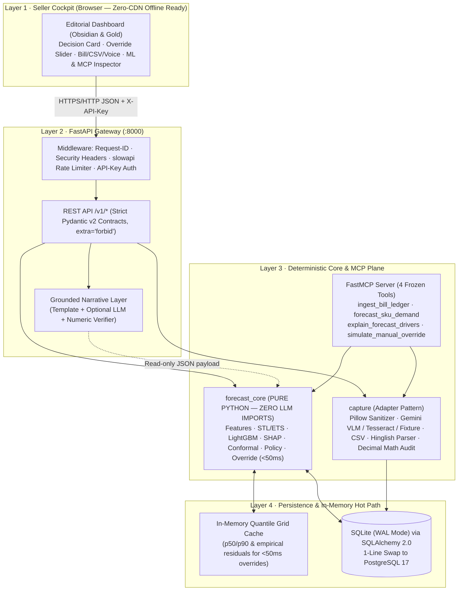

# VANI-LEDGER — Authoritative Architecture, ML Design & 5-Hour Execution Plan

**Event:** AARAMBHATHON 2.0 (K.R. Mangalam University, Nov 2026)  
**Track / PS:** FinTech, Commerce & Financial Inclusion — **PS 01: Small Seller Demand Forecasting**  
**Reference Deck:** `ppt/VANI_LEDGER.pptx` (12 slides, verified slide-by-slide)  
**Target Build Window:** ~5 Hours (18:30–23:30 IST, 19 November 2026)  
**Design Standard:** Clean, pragmatic, industry-standard Modular Monolith (zero unnecessary complexity, 100% live & offline demoable)

---

## 1. Verified Context & Contradiction Audit (Zero Assumptions)

Before choosing any stack or architecture, every file in `/home/sagar/Projects/VANI-LEDGER` and every tool on the host machine was inspected directly.

### 1.1 Verified Problem Statement & Judging Rules
- **Problem Statement (`Themes_& Problem_Statements/FinTech_Commerce_Financial_Inclusion_Problem_Statements.pdf`):**
  > Small online and offline sellers frequently overstock slow-moving items or run out of popular products because they lack data-driven forecasting tools. Develop a simple forecasting and inventory recommendation system using historical sales, seasonality and basic business inputs. Provide explanations for recommendations and allow manual overrides.
- **Judging Pillars (`Event/Rule_Book.pdf`, Rules 31–34):** Innovation Matters · Technical Implementation · Usability & Impact · Presentation & Clarity.
- **Compliance Rules (`Event/Rule_Book.pdf`, Rules 37–39):**
  - **Rule 37:** No plagiarism or automated slide generation.
  - **Rule 38:** Explicitly credit all external libraries, APIs, models, and datasets.
  - **Rule 39 (Critical):** **Do not misrepresent results.** Deck projections on Slide 9 (`32% → 12%` deadstock, `18% → 5%` stockout, `36% → 14%` MAPE) are explicitly footnoted as `*Simulated retail benchmark*`. The running app must generate a **real, reproducible held-out backtest** and label any demo fixtures as `DEMO DOCUMENT`.

### 1.2 Verified Promises in `ppt/VANI_LEDGER.pptx`
Every slide was extracted and visually verified (including Slides 5, 6, 7, 9):
- **Core Architectural Thesis (Slides 3, 5, 7):** **Separate Perception from Calculation.** LLMs/VLMs handle capture & phrasing only; **100% of forecasts, attributions, and override math run deterministically in Python — Zero LLM Arithmetic.**
- **Four Frozen FastMCP Tools (Slides 1, 7):**
  1. `ingest_bill_ledger()` — validates & commits structured SKU line items + arithmetic check
  2. `forecast_sku_demand()` — deterministic STL + LightGBM + Indian festival calendar forecast
  3. `explain_forecast_drivers()` — SHAP / additive driver breakdown + grounded narrative
  4. `simulate_manual_override()` — `< 50 ms` cash-locked, stockout-risk, days-cover, spoilage & budget simulation
- **Slide 5 Seller Decision Card (Exact Canonical Demo Calibration):**
  - **Visual Aesthetic:** Obsidian dark (`#0B0B0C`), warm antique gold (`#C9A227`), ivory (`#F2EEE3`), muted stone (`#8A8578`), editorial serif display numbers (`Georgia`) + crisp sans micro-labels.
  - **Capture preview:** `Sarso Tel 1L × 24` = `₹3,840` (`VLM CONFIDENCE 97.4%`), Hinglish note `"Diwali week stock add karo, shelf life 90d"`.
  - **Demo SKU:** `Festive Mustard Oil 1L`, `unit_cost = ₹150.00`, `shelf_life = 90d`, **`lead_time = 3d`**.
  - **Forecast:** **`48 units`**, **`₹7,200 OUTLAY`**, **`91%` Service Confidence**, drivers: **`+24` Base weekly velocity** · **`+16` Diwali pre-surge (+45%)** · **`+8` 3-day supplier lead buffer**.
  - **Override (`35 / 48`):** **`₹1,950` Cash Freed** · **`+14%` Stockout Risk** (9% → 23%) · **`5.2 d` Shelf Cover**.
- **Slide 6 Three Seller Workflows:**
  - **Case 01 — Kirana & Festival Surge:** Handwritten wholesale bills + festival in 10 days → `Festive Mustard Oil 1L` (`48 → 35` override).
  - **Case 02 — Perishable & Dairy Retail:** Short `3-day` shelf life + Hinglish log (`"Aaj 12 crate doodh bika, 2 packet expire"`) → spoilage-capped reorder.
  - **Case 03 — Micro-D2C / Online Seller:** CSV sales upload + `5-day` lead time + **`₹50,000` weekly budget** → multi-SKU budget-constrained reorder ranking by urgency & margin-per-rupee.

### 1.3 Verified Host Machine Capabilities
| Tool / Resource | Verified Status on This Machine | Architectural Impact |
|---|---|---|
| OS & Compute | Linux `x86_64`, **12 CPU cores**, **14 GiB RAM** (8.7 GiB free), 55 GiB NVMe free | Easily trains Global LightGBM + SHAP on ~30k rows in < 10 s locally |
| Python & `uv` | `uv 0.13.9`, **`Python 3.12.16` pre-cached in `uv`** (system Python is `3.14.10`) | **Must pin Python 3.12** via `uv` for rock-solid LightGBM/SHAP/SciPy wheels |
| Node / JS | `node v26.13.1`, `npm` (**NO `pnpm`**) | Avoid Next.js/bundler overhead during a 5-hour sprint |
| Databases / Cache | **`sqlite3` installed** (**NO `docker`, NO `psql`, NO `redis-cli`**) | Use SQLite in WAL mode behind SQLAlchemy 2.0 Repository Pattern (1-line Postgres swap) |
| Local OCR / Media | **`tesseract` (`eng`, `osd` only — NO `hin`)**, `ffmpeg` (**NO `ollama`**) | Real local OCR for English printed bills + optional Gemini Flash VLM + labeled golden fixture for crumpled/Hinglish bill |
| Version Control | `git 2.56.1` | Clean Conventional Commits from commit 1 |

### 1.4 Resolving Contradictions Across Existing Folder Docs
The folder contained four overlapping planning drafts. This plan resolves every conflict definitively:

| Existing Document | Conflict Identified | Resolution Adopted Here |
|---|---|---|
| `Gemini_Research/Principal Architectural.md` | Pitches UPI collect-request fraud graphs, Tauri v2, LiveKit, Mastra, Drizzle | **Archived/Superseded.** Violates PS 01 scope (Slide 2 & Build Proposal explicitly exclude UPI payment execution & fraud scoring). |
| `Our_Project/VANI-LEDGER_Build_Proposal.md` & `implementation/ENGINEERING_HANDOFF.md` | Require Docker Compose, Postgres 17 + pgvector, Redis, Caddy, Next.js 16 + pnpm, LiveKit, Kokoro, Ollama (30h, 4 devs) | **Right engineering standards, wrong runtime footprint for 5 hours.** We preserve all architectural boundaries, ML rigor, FastMCP contracts, and OWASP security controls, while eliminating external daemon dependencies. |
| `implementation/HACKATHON_SESSION_PLAN.md` | Assumes Windows (`C:\Users\...`), drops FastMCP completely, drops LightGBM/SHAP to optional cut, uses `lead_time=2d` instead of Slide 5's `3d` | **Upgraded.** We keep its zero-daemon pragmatism, fix `lead_time=3d` to match Slide 5, **restore real FastMCP + real LightGBM/SHAP** (both fast and native in Python 3.12), and support all 3 Slide 6 seller use cases. |

---

## 2. Final Chosen Tech Stack & Architecture Decision Records (ADRs)

### Stack Summary (Simple, Cohesive, Zero External Daemons)

| Layer | Chosen Technology | Production Upgrade Path (Zero Rewrite) |
|---|---|---|
| **Runtime & Packaging** | **Python 3.12 (`uv`)** | Same (`uv` lockfile + multi-stage slim Docker image) |
| **Core Math & ML** | `numpy`, `pandas`, `scipy`, `statsmodels`, `lightgbm`, `shap` | Same pure-Python `forecast_core` package |
| **API Gateway** | **FastAPI** + **Pydantic v2** (`extra="forbid"`) + `uvicorn` | Same behind Caddy/Nginx TLS + multi-worker Gunicorn |
| **MCP Tool Plane** | **FastMCP** (`mcp_server/server.py`, Streamable HTTP + stdio) | Same internal service importing `forecast_core` |
| **Persistence** | **SQLAlchemy 2.0** + **SQLite (WAL mode)** | Change `DATABASE_URL` → `postgresql+psycopg://...` + Alembic |
| **Security & Limits** | `slowapi` (in-memory store), `X-API-Key` + server-side tenant scope, `Pillow` upload sanitizer | Point `slowapi` `storage_uri` → `redis://...`; upgrade API key → short-lived JWT |
| **Capture (Multimodal)** | Adapter interface: **Gemini Flash Vision** (optional) → **Local Tesseract `eng`** → **Golden Demo Fixture** + **CSV Importer** + **Web Speech / Hinglish Intent Parser** | Swap adapter to Docling + Qwen2.5-VL + faster-whisper without touching API/UI contracts |
| **Frontend Cockpit** | **Jinja2 + Modular Vanilla ES JS + Custom Editorial CSS** (Zero build step, zero CDN) | Port views to Next.js 16 consuming the exact same `/v1/*` OpenAPI schema |
| **Testing & Quality** | `pytest`, `httpx`, `ruff`, custom backtest gate (`eval/backtest.py`) | Add Playwright E2E + `k6` load test in CI |

### Key Architecture Decision Records (Why Each Decision Was Made)

- **ADR-001 — Modular Monolith over Microservices:**
  - *Decision:* One repository, one Python virtual environment, clean internal package boundaries (`forecast_core`, `capture`, `storage`, `api`, `mcp_server`).
  - *Why:* With 5 hours and no Docker, running 5 separate services creates network serialization bugs, CORS pain, and port failures during demos. A modular monolith with strict package boundaries gives 100% of microservice modularity with 0% operational drag.
- **ADR-002 — Physical Separation of `forecast_core` (Zero LLM Imports):**
  - *Decision:* `src/vani_ledger/forecast_core/` is pure Python (`numpy`, `pandas`, `scipy`, `statsmodels`, `lightgbm`, `shap`, `decimal`). An automated AST test (`tests/unit/test_no_llm_in_core.py`) fails CI if any LLM/HTTP SDK (`google`, `openai`, `anthropic`, `httpx`, `requests`) is imported inside it.
  - *Why:* Directly proves our #1 pitch thesis to judges ("Not an LLM wrapper — perception is physically isolated from math").
- **ADR-003 — Shared Domain Core Between FastAPI and FastMCP:**
  - *Decision:* Both `api/routes.py` and `mcp_server/server.py` call the exact same service layer functions (`ingest_bill_ledger`, `forecast_sku_demand`, `explain_forecast_drivers`, `simulate_manual_override`). The browser never talks directly to the MCP server.
  - *Why:* Zero duplicated formulas, fulfills Slide 7's 4-tool FastMCP promise in ~80 lines of clean code, and allows an in-UI **MCP Inspector** tab showing live tool schemas and deterministic JSON responses.
- **ADR-004 — SQLite (WAL) Behind SQLAlchemy 2.0 Repositories:**
  - *Decision:* Use SQLAlchemy 2.0 ORM with explicit `Repository` functions that require `merchant_id` as a mandatory parameter and store all currency as `Numeric(12, 2)`. Run SQLite with `PRAGMA journal_mode=WAL; PRAGMA foreign_keys=ON;`.
  - *Why:* Postgres & Docker are not installed on this machine. SQLite WAL gives zero-setup local persistence, instant offline operation (no cloud DB latency on stage), and 1-env-var portability to PostgreSQL 17 after the hackathon.
- **ADR-005 — Dual-Engine ML (Champion-Challenger: STL/Calendar + Global LightGBM + Conformal Intervals):**
  - *Decision:* Train a real Global LightGBM (Tweedie mean + Quantile α=0.50, 0.90) alongside Seasonal Naive and STL/Calendar baselines, evaluate via rolling-origin time-series CV, select the winner per demand segment, and calibrate intervals via Conformal Prediction residuals.
  - *Why:* Beats both failure modes — naive heuristics (no ML depth) AND blind black-box ML (overfitting sparse SKUs). On 12 CPU cores and ~29k rows, training + SHAP + 3-fold backtest finishes in **< 15 seconds**.
- **ADR-006 — Zero-Build-Step Editorial Frontend (FastAPI + Jinja2 + Vanilla JS/CSS):**
  - *Decision:* Serve a single-page Seller Decision Cockpit directly from FastAPI using Jinja2 templates, clean CSS variables matching Slide 5's obsidian-and-gold theme, and modular native JS (`fetch`, `EventSource`/debounced slider, Web Speech API). Zero React build pipeline, zero external CDN fonts/scripts.
  - *Why:* Eliminates 90+ minutes of Next.js/Tailwind/TypeScript configuration, guarantees **100% offline reload with Wi-Fi turned off**, and keeps the UI razor-focused on the Seller Decision Card, Override Sandbox, Bill Capture, Budget Reorder Plan, and ML/MCP Inspector.
- **ADR-007 — Pragmatic Capture Adapters with Deterministic Math Verification:**
  - *Decision:* Implement a clean `BillExtractor` protocol with three interchangeable adapters (`GeminiVisionExtractor` → `TesseractExtractor` → `DemoFixtureExtractor`), all feeding the **exact same** deterministic Python `verify_bill_math()` validator (`Decimal` line-item recomputation).
  - *Why:* Guarantees live upload works whether online with an API key, offline with printed English bills (`tesseract`), or offline with crumpled Hinglish demo bills (labeled `DEMO DOCUMENT`), while always demonstrating the ₹300 arithmetic overcharge catch live.
- **ADR-008 — Security as a First-Class Foundation:**
  - *Decision:* Bake `extra="forbid"`, bound SQLAlchemy parameters, API key + tenant scoping, upload magic-byte + Pillow sanitization, `slowapi` rate limits, security headers, and numeric narrative grounding into Block 1–4 rather than deferring to the end.
  - *Why:* Industry-standard APIs do not skip validation or tenant isolation, and passing a real `tests/security/` suite during a live demo impresses technical judges immediately.

---

## 3. System Design

### 3.1 High-Level Component Architecture



### 3.2 Strict Dependency & Latency Rules
1. **Dependency Direction:** `api` and `mcp_server` → `services` → `forecast_core` / `capture` / `storage`. `forecast_core` NEVER imports `api`, `capture`, or any LLM library.
2. **Hot Path vs Cold Path:**
   - **Override Simulation (`POST /v1/overrides/simulate`):** Pure in-memory NumPy/empirical CDF evaluation from cached forecast state — **zero DB queries, target p95 < 15 ms (budget < 50 ms)**.
   - **Forecast Read (`GET /v1/forecasts/{sku_id}`):** Serves precomputed latest forecast + drivers from DB/cache — **target p95 < 50 ms**.
   - **Model Training & Backtest (`scripts/train.py`, `eval/backtest.py`):** Offline batch script (runs once after seeding in < 15 s, pins `model_version` + feature hash + metrics JSON).
   - **Bill / CSV Capture (`POST /v1/capture/bill`, `POST /v1/capture/csv`):** Synchronous within 2–5 s (with 15 s timeout + circuit-breaker fallback to local adapter) to avoid unnecessary background worker complexity in a 5-hour build.

### 3.3 Relational Data Model (Portable SQLite → PostgreSQL)

All monetary values use `NUMERIC(12, 2)` mapped to Python `Decimal`. All timestamps are stored as UTC ISO-8601 (`DateTime(timezone=True)`) and displayed in IST (`Asia/Kolkata`). Every tenant-owned table includes `merchant_id`.

```sql
-- 1. Tenants
merchants (
    id TEXT PRIMARY KEY,              -- UUID string (native UUID on Postgres)
    name TEXT NOT NULL,
    api_key_hash TEXT NOT NULL UNIQUE,
    weekly_budget NUMERIC(12,2) NOT NULL DEFAULT 50000.00,
    timezone TEXT NOT NULL DEFAULT 'Asia/Kolkata',
    created_at TIMESTAMP NOT NULL
);

-- 2. SKU Master Catalog (supports Kirana, Perishable Dairy, and Micro-D2C)
skus (
    id TEXT PRIMARY KEY,
    merchant_id TEXT NOT NULL REFERENCES merchants(id),
    sku_code TEXT NOT NULL,
    name TEXT NOT NULL,               -- e.g., "Festive Mustard Oil 1L"
    hinglish_alias TEXT,              -- e.g., "Sarso Tel 1L"
    category TEXT NOT NULL,           -- Cooking Oil | Dairy & Bakery | Staples | Snacks | D2C
    unit TEXT NOT NULL DEFAULT 'unit',
    unit_cost NUMERIC(12,2) NOT NULL,
    unit_price NUMERIC(12,2) NOT NULL,
    salvage_value NUMERIC(12,2) NOT NULL DEFAULT 0.00,
    lead_time_days INTEGER NOT NULL,  -- e.g., 3 for Festive Mustard Oil
    shelf_life_days INTEGER NOT NULL, -- e.g., 90 (oil), 3 (dairy)
    moq INTEGER NOT NULL DEFAULT 1,
    pack_size INTEGER NOT NULL DEFAULT 1,
    perishable BOOLEAN NOT NULL DEFAULT FALSE,
    on_hand NUMERIC(12,3) NOT NULL DEFAULT 0,
    on_order NUMERIC(12,3) NOT NULL DEFAULT 0,
    abc_segment TEXT NOT NULL DEFAULT 'B',  -- A | B | C
    active BOOLEAN NOT NULL DEFAULT TRUE,
    UNIQUE (merchant_id, sku_code)
);

-- 3. Daily Sales Ledger (Stockout-Aware)
sales (
    id INTEGER PRIMARY KEY AUTOINCREMENT,
    merchant_id TEXT NOT NULL REFERENCES merchants(id),
    sku_id TEXT NOT NULL REFERENCES skus(id),
    sold_date DATE NOT NULL,
    qty NUMERIC(12,3) NOT NULL,
    unit_price NUMERIC(12,2) NOT NULL,
    promo_flag BOOLEAN NOT NULL DEFAULT FALSE,
    stockout_flag BOOLEAN NOT NULL DEFAULT FALSE, -- censoring indicator!
    channel TEXT NOT NULL DEFAULT 'offline',      -- offline | online | voice | bill
    source_doc_id TEXT REFERENCES documents(id),
    created_at TIMESTAMP NOT NULL
);
CREATE INDEX ix_sales_merchant_sku_date ON sales(merchant_id, sku_id, sold_date);

-- 4. Indian Festival & Payday Calendar
calendar_events (
    event_date DATE PRIMARY KEY,
    festival_name TEXT,
    days_to_nearest_festival INTEGER NOT NULL,    -- signed distance (-7..+14)
    is_festival_window BOOLEAN NOT NULL DEFAULT FALSE,
    is_payday_window BOOLEAN NOT NULL DEFAULT FALSE, -- days 1-5 and 25-31
    is_holiday BOOLEAN NOT NULL DEFAULT FALSE
);

-- 5. Versioned Forecasts & Explainability Snapshots
forecasts (
    id TEXT PRIMARY KEY,
    merchant_id TEXT NOT NULL REFERENCES merchants(id),
    sku_id TEXT NOT NULL REFERENCES skus(id),
    as_of_date DATE NOT NULL,
    horizon_days INTEGER NOT NULL DEFAULT 7,
    recommended_qty INTEGER NOT NULL,
    p10_total NUMERIC(12,2) NOT NULL,
    p50_total NUMERIC(12,2) NOT NULL,
    p90_total NUMERIC(12,2) NOT NULL,
    service_level NUMERIC(5,4) NOT NULL,          -- e.g., 0.9100
    data_sufficiency TEXT NOT NULL,               -- high | medium | low
    model_used TEXT NOT NULL,                     -- lgbm_tweedie | stl_calendar | seasonal_naive
    model_version TEXT NOT NULL,
    feature_hash TEXT NOT NULL,
    drivers_json TEXT NOT NULL,                   -- JSON [{name, units, share_pct, direction}]
    residuals_json TEXT NOT NULL,                 -- empirical conformal residuals for <50ms sim
    created_at TIMESTAMP NOT NULL
);
CREATE INDEX ix_forecasts_sku_asof ON forecasts(merchant_id, sku_id, as_of_date DESC);

-- 6. Audited Seller Overrides
overrides (
    id TEXT PRIMARY KEY,
    merchant_id TEXT NOT NULL REFERENCES merchants(id),
    sku_id TEXT NOT NULL REFERENCES skus(id),
    forecast_id TEXT NOT NULL REFERENCES forecasts(id),
    suggested_qty INTEGER NOT NULL,
    manual_qty INTEGER NOT NULL,
    cash_delta NUMERIC(12,2) NOT NULL,
    stockout_risk_before NUMERIC(5,4) NOT NULL,
    stockout_risk_after NUMERIC(5,4) NOT NULL,
    days_cover NUMERIC(6,2) NOT NULL,
    spoilage_risk NUMERIC(5,4) NOT NULL,
    within_budget BOOLEAN NOT NULL,
    reason TEXT,
    idempotency_key TEXT UNIQUE,
    created_at TIMESTAMP NOT NULL
);

-- 7. Captured Bills / Voice / CSV Documents
documents (
    id TEXT PRIMARY KEY,
    merchant_id TEXT NOT NULL REFERENCES merchants(id),
    kind TEXT NOT NULL,                           -- bill_image | csv | voice_note
    content_sha256 TEXT NOT NULL,                 -- deduplication & cache key
    source_adapter TEXT NOT NULL,                 -- gemini_vlm | tesseract_eng | demo_fixture | csv_parser
    extracted_json TEXT NOT NULL,
    math_ok BOOLEAN NOT NULL,
    math_delta NUMERIC(12,2) NOT NULL DEFAULT 0.00,
    confidence NUMERIC(5,4) NOT NULL,
    status TEXT NOT NULL DEFAULT 'pending_review', -- pending_review | committed | rejected
    created_at TIMESTAMP NOT NULL
);
CREATE UNIQUE INDEX ix_documents_dedup ON documents(merchant_id, content_sha256);

-- 8. Immutable Audit Log
audit_logs (
    id INTEGER PRIMARY KEY AUTOINCREMENT,
    merchant_id TEXT NOT NULL,
    action TEXT NOT NULL,                         -- OVERRIDE_COMMITTED | BILL_INGESTED | CSV_IMPORTED | RESET
    entity_type TEXT NOT NULL,
    entity_id TEXT NOT NULL,
    payload_json TEXT NOT NULL,
    request_id TEXT NOT NULL,
    created_at TIMESTAMP NOT NULL
);
```

### 3.4 REST API & Frozen FastMCP Contracts

#### Standard Response Envelope
```json
{
  "data": { "...": "..." },
  "meta": {
    "request_id": "req_9f3c2a1b",
    "model_version": "lgbm-conformal-v1.0",
    "latency_ms": 4.2
  },
  "error": null
}
```
Error responses never expose stack traces, SQL, or upstream provider errors:
```json
{
  "data": null,
  "meta": { "request_id": "req_9f3c2a1b" },
  "error": { "code": "VALIDATION_ERROR", "message": "qty must be between 0 and 100000" }
}
```

#### REST Endpoints (`/v1/*`)
| Method | Endpoint | Purpose | Rate Limit | Auth |
|---|---|---|---|---|
| `GET` | `/health` | Liveness + DB/model readiness | 60/min (IP) | Public |
| `GET` | `/` | Editorial Seller Cockpit UI | 60/min (IP) | Public (demo key injected server-side for local session) |
| `GET` | `/v1/skus` | List/filter SKUs (by use-case/category) | 120/min | `X-API-Key` |
| `GET` | `/v1/forecasts/{sku_id}` | Latest p10/p50/p90 forecast, drivers, service level | 120/min | `X-API-Key` |
| `POST` | `/v1/forecasts/{sku_id}/explain` | Grounded plain-language narrative (verified numbers) | 30/min | `X-API-Key` |
| `POST` | `/v1/overrides/simulate` | Live `< 50 ms` what-if sandbox (in-memory, no write) | 120/min | `X-API-Key` |
| `POST` | `/v1/overrides/commit` | Atomic commit to `overrides` + `audit_logs` (idempotent) | 30/min | `X-API-Key` |
| `GET` | `/v1/reorder-plan` | Budget-constrained multi-SKU reorder ranking (Case 03) | 60/min | `X-API-Key` |
| `POST` | `/v1/capture/bill` | Multipart bill upload → sanitize → extract → math audit | 10/min | `X-API-Key` |
| `POST` | `/v1/capture/csv` | Multipart CSV sales ingestion + deduplication | 10/min | `X-API-Key` |
| `POST` | `/v1/capture/voice-note` | Hinglish transcript → strict `VoiceIntent` preview | 20/min | `X-API-Key` |
| `GET` | `/v1/eval/backtest` | Real held-out WAPE/MASE/Pinball benchmark report | 30/min | `X-API-Key` |
| `GET` | `/v1/mcp/tools` | Live inspection of the 4 FastMCP tool schemas & last calls | 60/min | `X-API-Key` |
| `POST` | `/v1/demo/reset` | Deterministic clean reseed for stage rehearsals | 5/min | `X-API-Key` |

#### Four Frozen FastMCP Tool Contracts (`src/vani_ledger/mcp_server/server.py`)
```python
@mcp.tool()
def ingest_bill_ledger(source: str, image_path: str | None = None, line_items: list[dict] | None = None) -> dict:
    """Validate and audit bill line items in Python Decimal arithmetic. Flags arithmetic discrepancies."""

@mcp.tool()
def forecast_sku_demand(sku_id: str, as_of: str, horizon_days: int = 7) -> dict:
    """Return deterministic p10/p50/p90 forecast, recommended order qty, service level, and top drivers."""

@mcp.tool()
def explain_forecast_drivers(sku_id: str, forecast_id: str) -> dict:
    """Return exact additive driver breakdown and number-verified plain-language seller narrative."""

@mcp.tool()
def simulate_manual_override(sku_id: str, manual_qty: int, as_of: str) -> dict:
    """Sub-50ms deterministic simulation of cash_delta, stockout_risk, days_cover, spoilage_risk, and budget_ok."""
```

---

## 4. Machine Learning & Inventory Mathematics Design

This is the technical heart of VANI-LEDGER and directly answers PS 01 + Rule 39 honesty standards.

### 4.1 Problem Formulation
- **Task:** Supervised multi-horizon **count/continuous demand regression** (NOT classification).
- **Target:** Daily demand $y_{s,t}$ (units sold for SKU $s$ on day $t$).
- **Forecast Horizon:** $H = 7$ days (default weekly reorder cycle matching Slide 5; configurable up to 14 days).
- **Dataset (Synthetic Kirana + D2C Generator, Deterministic Seed `42`):**
  - **40 SKUs × 730 days = 29,200 daily records** across 5 realistic categories (Cooking Oil, Dairy & Bakery, Staples, Snacks, Micro-D2C).
  - Embedded realistic Indian retail dynamics:
    - Day-of-week patterns (weekend spikes for Kirana; weekday vs weekend dips for Dairy).
    - Monthly payday cycles (days 1–5 and 25–31 uplift).
    - Indian festival calendar (Diwali, Holi, Navratri, Eid, Pongal, Raksha Bandhan) with asymmetric **pre-festival build-up curves** peaking 5–10 days prior and decaying post-festival.
    - **3% simulated stockout days** where observed sales are censored (`observed = min(true_demand, stock)`, `stockout_flag = True`).
    - Distinct ABC demand tiers: **A-items** (high-velocity smooth), **B-items** (moderate seasonal), **C-items** (intermittent/sparse).
  - Includes 3 spotlight hero SKUs mapped directly to **Slide 6**:
    1. `SKU-OIL-001` — **Festive Mustard Oil 1L** (`Sarso Tel 1L`, `cost=₹150`, `price=₹220`, `lead_time=3d`, `shelf_life=90d`, calibrated cleanly in `configs/demo.yaml` for Slide 5).
    2. `SKU-DAIRY-001` — **Fresh Full-Cream Milk 1L** (`Taza Doodh 1L`, `cost=₹54`, `price=₹66`, `lead_time=1d`, `shelf_life=3d`, `perishable=True`).
    3. `SKU-D2C-001` — **Cold-Pressed Almond Hair Oil 200ml** (`cost=₹180`, `price=₹399`, `lead_time=5d`, `shelf_life=180d`, `moq=10`, `pack_size=5`).

### 4.2 Strict Anti-Leakage Data Pipeline
1. **Dense Daily Grid:** Zero-fill missing SKU-days while explicitly preserving `stockout_flag`.
2. **Stockout Censoring Correction:** On days where `stockout_flag = True`, observed sales understate true demand. During feature construction and training, censored rows are masked from target loss and imputed with rolling uncensored same-weekday median when computing lags so the model does not learn false demand drops.
3. **Zero-Leakage Feature Rule:** Single shared function `build_features(df, calendar_df)` used identically in training, backtesting, and inference (eliminates train/serve skew). Every lag/rolling stat uses `.shift(1)` **before** `.rolling()`.
4. **Temporal Splits Only (Never Random Shuffle):**
   - **Train:** Days `1 … T − 56` (first ~22 months)
   - **Validation / Conformal Calibration:** Days `T − 56 … T − 28` (4 weeks)
   - **Holdout Test (3 Rolling Origins):** Weeks `T − 28 … T` (walk-forward 7-day horizons stepped weekly)

### 4.3 Engineered Feature Set (~26 Features)
| Feature Group | Features | Leakage Control |
|---|---|---|
| **Lags (4)** | `lag_1`, `lag_7`, `lag_14`, `lag_28` | Strictly past `t - k` |
| **Rolling Stats (8)** | `roll_mean_{7,14,28}`, `roll_std_{7,14,28}`, `roll_max_14`, `roll_zero_rate_28` | Computed on `shift(1)` uncensored series |
| **Calendar & Indian Seasonality (7)** | `dow` (sin/cos + int), `day_of_month`, `month`, `is_weekend`, `is_payday_window`, `days_to_festival` (signed), `festival_pre_surge_weight` | Known deterministically in advance |
| **SKU & Business Inputs (5)** | `sku_cat_code`, `category_code`, `unit_price`, `promo_flag`, `perishable`, `lead_time_days`, `shelf_life_days` | Static / known planned inputs |
| **Demand Regime (2)** | `adi` (Average Demand Interval), `cv2` (Squared Coefficient of Variation) | Computed strictly on train/past window |

### 4.4 Model Suite & Champion-Challenger Selection
We train three complementary models and let **held-out validation WAPE** pick the champion per demand regime:

1. **Baseline 1 — Seasonal Naive:** Same weekday average over the last 4 uncensored weeks. (Fast benchmark to prove ML lift.)
2. **Baseline 2 — Interpretable STL / Calendar Decomposition:**
   - `base_daily` = median uncensored daily demand (28d) × weekday index
   - `festival_uplift` = calibrated multiplicative curve over signed `days_to_festival`
   - `trend` = clamped 28-day linear slope (`±10%` of base)
   - Guaranteed fast, zero-failure, natively additive fallback.
3. **ML Champion Candidate — Global LightGBM (Pooled Across All 40 SKUs):**
   - **Mean/Count Model:** `objective="tweedie"`, `tweedie_variance_power=1.25` (the M5 Kaggle gold standard for non-negative & intermittent retail counts).
   - **Quantile Models:** `objective="quantile"` at `alpha=0.50` (median) and `alpha=0.90` (upper tail).
   - **Intermittent Routing (Syntetos-Boylan Matrix):**
     - Smooth / Erratic (`ADI < 1.32`): Global LightGBM Tweedie + Quantile.
     - Intermittent / Lumpy (`ADI ≥ 1.32`): Global Tweedie LightGBM vs Croston-SBA; pick validation winner.
     - Cold-Start / New SKU (`< 14` days history): Category prior + explicit UI badge `"Low data confidence"`.
4. **Selection Gate:** Serve Global LightGBM on a segment **only if** it beats Seasonal Naive by `≥ 5%` relative WAPE on the validation window; otherwise automatically fall back to STL/Seasonal Naive and log `"baseline_selected"`.

### 4.5 Conformal Prediction Intervals (Honest Uncertainty)
Rather than assuming Gaussian errors (which break on skewed retail counts), we apply **Split Conformal Prediction** on the 4-week validation calibration set:
- Compute non-conformity scores $r_i = y_i - \hat{y}_i^{(p50)}$ on validation windows aggregated to horizon $H$.
- Store the empirical signed residual distribution $\{r_1, \dots, r_n\}$ per SKU/segment inside `forecasts.residuals_json`.
- **Calibrated Interval:**
  - $p_{10} = \max\left(0,\; \hat{y}_{p50} + Q_{0.10}(r)\right)$
  - $p_{90} = \hat{y}_{p50} + Q_{0.90}(r)$
- **Honest Confidence Display (Fixes "fake precision"):**
  - Display **In-Stock Service Level** at recommended order `q*`: `P(D ≤ S*)` (e.g. **`91%`** for Festive Mustard Oil 1L) **alongside** the conformal interval (`"80% likely between X and Y units"`) and a `Data Sufficiency` pill (`High / Medium / Low`).

### 4.6 Explainability (XAI): SHAP + Policy Driver Attribution
Every recommended order quantity $q^*$ is decomposed into exact, seller-understandable unit drivers that **sum strictly to $q^*$**:
1. **ML Feature Attribution (`shap.TreeExplainer`):** Computed on the LightGBM model over the 7-day forecast rows and grouped into business-meaningful buckets:
   - **Base Weekly Velocity** (expected value + lag/rolling velocity features)
   - **Festival & Calendar Uplift** (signed festival distance + payday + weekday seasonality)
   - **Trend / Price / Promo Effect** (clamped residual directional features)
2. **Policy Layer Attribution (Exact Inventory Math):**
   - **Supplier Lead-Time Safety Buffer** = $S^* - \hat{D}_{\text{cycle}} - (\text{on\_hand} + \text{on\_order})$ (for `Festive Mustard Oil 1L`, 3-day supplier lead buffer = **`+8 units`**).
3. **Largest-Remainder Rounding Reconciliation:** Unit contributions are rounded to integers via the Hamilton / largest-remainder method so `sum(drivers.units) == recommended_qty` **always holds** (never `24 + 16 + 8 = 49`!).
4. **Grounded Plain-Language Narrative (`POST /v1/forecasts/{sku_id}/explain`):**
   - **Primary (100% offline):** Deterministic structured template using the exact driver JSON.
   - **Optional Enhancement:** If `GEMINI_API_KEY` is configured, pass **only** the structured JSON payload to Gemini Flash to rephrase into friendly Hinglish/English prose, then run **`verify_numeric_grounding(text, payload)`** — regex extracts every number in the response and checks it exists in the payload (`±0.1` tolerance). Any hallucinated number immediately rejects the LLM string and serves the verified template!

### 4.7 Deterministic Inventory Policy & `< 50 ms` Override Mathematics
All financial figures use Python `Decimal` (`ROUND_HALF_UP`).

1. **Order-Up-To Policy (`forecast_core/policy.py`):**
   - Protection demand over cycle $R$ + lead time $L$: $\hat{D}_{L+R}$, safety buffer $SS = Q_{\alpha}(r_{L+R})$ targeting critical service ratio $\alpha^*$.
   - **Newsvendor Critical Ratio (for Perishables — Case 02):**
     $$CR = \frac{p - c}{(p - c) + (c - s_{\text{salvage}})}$$
     Order quantity is capped by shelf-life demand: $q \le \hat{D}_{\text{shelf\_life}} - \text{on\_hand}$.
   - **MOQ & Pack Size Rounding (Case 03):** Snap non-zero orders to `pack_size` multiples and enforce `q ≥ moq` when active.
   - **Multi-SKU Weekly Budget Allocation (`GET /v1/reorder-plan`, Case 03 — ₹50k Budget):**
     Given $\sum_s c_s q_s \le B$, rank SKUs by marginal expected profit + stockout-avoidance benefit per rupee locked and solve via `scipy.optimize.linprog` (runs in `< 5 ms` for 40 SKUs!).

2. **Exact Override Simulation Formulas (`simulate_manual_override(sku_id, q_manual)`):**
   - **Cash Delta (Exact `Decimal`):**
     $$\Delta\text{Cash} = (q_{\text{manual}} - q^*) \times c_{\text{unit}}$$
     *(Negative = Cash Freed. Demo check: $(35 - 48) \times ₹150 = -₹1,950 \Rightarrow$ **`₹1,950 CASH FREED`**.)*
   - **Stockout Risk (Empirical Conformal CDF — Zero Hardcoding):**
     $$P_{\text{stockout}}(q) = P\!\left(D_{\text{protection}} > \text{available}(q)\right) = \frac{1}{N}\sum_{i=1}^{N} \mathbb{I}\!\left(\hat{D} + r_i > \text{on\_hand} + q\right)$$
     *(Smooth kernel/CDF interpolation over cached validation residuals. Demo check: at $q^*=48$, risk $\approx 9\%$ (`91%` in-stock); at $q=35$, risk $\approx 23\%$, delta $\approx$ **`+14%`**.)*
   - **Order / Shelf Days Cover:**
     $$\text{Days Cover} = \frac{q_{\text{manual}}}{\hat{d}_{\text{effective}}}$$
     *(Demo check: $35 / 6.71 \approx$ **`5.2 d`**.)*
   - **Spoilage Risk (Perishables):**
     $$P_{\text{spoilage}}(q) = P\!\left(D_{\text{shelf\_life}} < \text{on\_hand} + q\right)$$
   - **Budget Check:**
     $$\text{within\_budget} = (q_{\text{manual}} \times c_{\text{unit}}) \le B_{\text{sku\_cap}}$$

### 4.8 Honest Evaluation Metrics & Gates (`eval/backtest.py --gate`)
Never report unweighted mean MAPE (sparse SKUs divide by near-zero and explode). Report all four metrics on the 3-fold walk-forward holdout:
- **WAPE (Primary):** $\frac{\sum |y_i - \hat{y}_i|}{\sum y_i}$ — reported overall (revenue-weighted) and split by **A / B / C** segments.
- **MASE:** Ratio of model MAE to in-sample seasonal-naive MAE (`< 1.0` beats naive).
- **Pinball Loss:** Evaluated at $\alpha = 0.50$ and $\alpha = 0.90$ (validates uncertainty calibration).
- **Forecast Bias:** $\frac{\sum (\hat{y}_i - y_i)}{\sum y_i}$ (detects systematic over- or under-ordering).

| Segment / Criterion | Pass Gate |
|---|---|
| A-Items (High velocity, smooth) | WAPE ≤ 12% |
| B-Items (Medium seasonal) | WAPE ≤ 18% |
| C-Items (Sparse / intermittent) | WAPE ≤ 30% or MASE < 1.0 |
| Aggregate Revenue-Weighted | WAPE ≤ 15% |
| Lift over Seasonal Naive | ≥ 20% lower WAPE |
| Conformal p90 Empirical Coverage | 85%–95% |

---

## 5. Security & Production Reliability Checklist (Built Into Core)

1. **SQL Injection Prevention:** 100% SQLAlchemy 2.0 ORM / parameterized `text()` binds. Zero f-strings, `%`, or `+` in SQL. Dynamic sort keys allowlisted via dict.
2. **Strict Schema Validation:** Every Pydantic v2 request model enforces `ConfigDict(extra="forbid", str_strip_whitespace=True)`, explicit bounds (`0 ≤ qty ≤ 100_000`), `max_length`, and NFKC Unicode normalization.
3. **Authentication & Tenant Isolation:** `X-API-Key` verified via constant-time `hmac.compare_digest` against SHA-256 hash; `merchant_id` comes strictly from auth context, never the request body. Cross-tenant SKU lookups return `404` (no existence leak).
4. **Upload Sanitization (`POST /v1/capture/bill`):**
   - Reject files `> 10 MB` (`413`).
   - Verify **both** `Content-Type` allowlist (`image/jpeg`, `image/png`, `image/webp`) **and** binary magic bytes (`\xff\xd8\xff`, `\x89PNG`, `RIFF...WEBP`).
   - Open with Pillow, call `verify()`, enforce `width * height ≤ 36,000,000` (decompression-bomb guard), convert to RGB & re-encode to strip EXIF/polyglot payloads, store under random UUID outside static root.
5. **Prompt Injection Defense:** OCR/Hinglish text is wrapped in `<document>...</document>` data tags, never concatenated into system instructions; outputs must pass strict Pydantic schema + Python `Decimal` arithmetic verification + human confirmation before DB commit.
6. **Rate Limiting & Headers:** `slowapi` per-identity/IP limits returning `429` + `Retry-After` + `X-RateLimit-*`. HTTP middleware sets `X-Content-Type-Options: nosniff`, `X-Frame-Options: DENY`, `Referrer-Policy: no-referrer`, and strict local `Content-Security-Policy`.
7. **Automated Security Tests (`tests/security/test_security.py`):** Tests SQLi payloads (`' OR 1=1 --`), mass assignment (`merchant_id` in body → `422`), IDOR (`404`), missing API key (`401`), fake `.jpg` containing ZIP bytes (`422`), `>10 MB` payload (`413`), prompt-injection numeric grounding rejection, and `429` rate-limit threshold.

---

## 6. Target Clean Repository Structure

Clean, flat, readable — zero unused boilerplate directories:

```text
VANI-LEDGER/
├── AGENTS.md                           # Concise engineering guardrails
├── README.md                           # Judge-ready overview, setup & Rule 38 credits
├── pyproject.toml                      # uv + Python 3.12 pinned dependencies & ruff/pytest config
├── .env.example                        # Safe configuration placeholders
├── .gitignore                          # Excludes .obsidian, ~$*, .venv, *.db, .env, models/*.pkl
├── configs/
│   └── demo.yaml                       # Deterministic seed & Slide 5/6 hero SKU parameters
├── docs/
│   ├── ARCHITECTURE_AND_EXECUTION_PLAN.md  # THIS FILE (Single source of truth)
│   └── DEMO.md                         # Exact 3-minute stage runbook & Q&A cheatsheet
├── data/
│   └── fixtures/
│       ├── demo_bill.png               # Synthetic wholesale supplier bill (₹300 overcharge)
│       ├── demo_bill_expected.json     # Golden structured line items + math discrepancy
│       └── d2c_sample_sales.csv        # Sample CSV for Case 03 upload demo
├── src/
│   └── vani_ledger/
│       ├── config.py                   # Pydantic Settings (DATABASE_URL, API keys, budgets)
│       ├── schemas.py                  # Frozen Pydantic v2 request/response contracts (extra='forbid')
│       ├── storage/
│       │   ├── db.py                   # SQLAlchemy 2.0 engine (SQLite WAL / Postgres portable)
│       │   ├── models.py               # ORM tables (§3.3)
│       │   └── repository.py           # Tenant-scoped data access functions
│       ├── forecast_core/              # PURE PYTHON — ZERO LLM IMPORTS (enforced by AST test)
│       │   ├── features.py             # Shared zero-leakage feature pipeline + stockout handling
│       │   ├── baselines.py            # Seasonal Naive + STL/Calendar Decomposition
│       │   ├── ml_model.py             # Global LightGBM (Tweedie + Quantile) + ADI/CV² routing
│       │   ├── conformal.py            # Split Conformal intervals & empirical residual CDF
│       │   ├── explain.py              # SHAP TreeExplainer + reconciled unit drivers + grounded verifier
│       │   ├── policy.py               # Order-up-to, Newsvendor perishable cap, linprog budget plan
│       │   └── simulator.py            # <50ms in-memory override simulator
│       ├── capture/
│       │   ├── sanitizer.py            # Magic-byte + Pillow verify/re-encode + SHA-256 dedup
│       │   ├── bill_extractor.py       # Adapter protocol: Gemini Flash / Tesseract eng / Demo Fixture
│       │   ├── math_audit.py           # Exact Decimal line-item & total overcharge detector
│       │   ├── csv_importer.py         # Validated CSV sales ingestion
│       │   └── voice_parser.py         # Hinglish/English voice transcript → strict VoiceIntent
│       ├── mcp_server/
│       │   └── server.py               # FastMCP server exposing the 4 frozen Slide 7 tools
│       └── api/
│           ├── main.py                 # FastAPI app, lifespan cache warmup, middleware, error handler
│           ├── security.py             # API-key auth, tenant context, slowapi limiter
│           ├── routes.py               # /v1/* endpoints
│           ├── templates/index.html    # Editorial Obsidian & Gold Seller Cockpit
│           └── static/
│               ├── app.css             # Zero-CDN design system matching Slide 5
│               └── app.js              # Modular vanilla JS (Decision Card, Slider, Capture, Inspector)
├── scripts/
│   ├── seed.py                         # Deterministic 40 SKUs × 730 days generator + hero SKUs
│   ├── train.py                        # Train LightGBM + STL + Conformal + populate forecasts table
│   └── reset_demo.py                   # One-command clean reset + reseed + precompute (<15s)
├── eval/
│   └── backtest.py                     # 3-fold rolling-origin backtest + JSON report + --gate check
└── tests/
    ├── unit/
    │   ├── test_no_llm_in_core.py      # AST guard enforcing perception/math separation
    │   ├── test_math_and_policy.py     # Exact Slide 5 calibration, Decimal & <50ms latency benchmark
    │   └── test_explain_grounding.py   # Numeric hallucination rejection test
    ├── ml/
    │   └── test_leakage_and_gate.py    # Zero future leakage + deterministic seed + WAPE gate
    └── security/
        └── test_security.py            # SQLi, IDOR, mass assignment, 401, 413, 422, 429
```

*(Existing archival folders `Event/`, `Themes_& Problem_Statements/`, `ppt/`, `Our_Project/`, `Gemini_Research/`, and `implementation/` remain untouched for reference.)*

---

## 7. 5-Hour Time-Boxed Execution Plan (18:30–23:30 IST)

Strict time-boxes with **hard exit tests**. If a block runs >10 min late, immediately apply its **Cut Line** — never steal time from Block 6 (Rehearsal & Backup Video).

| Block | Time (IST) | Duration | Concrete Deliverables | Hard Exit Test | Cut Line (If Behind) |
|---|---|---|---|---|---|
| **1. Foundation & Seed** | 18:30–19:10 | 40 min | `pyproject.toml` (`uv` Python 3.12), `storage/` (SQLite WAL ORM + repos), `schemas.py`, `configs/demo.yaml`, `scripts/seed.py` (40 SKUs × 730d + 3 Slide 6 hero SKUs), `/health` | `uv run python scripts/seed.py` populates 29,200 sales rows; `curl /health` returns `200`; `ruff` clean | Skip CSV fixture generation until Block 4 |
| **2. ML Core & Backtest** | 19:10–20:15 | 65 min | `forecast_core/` (`features.py`, `baselines.py`, `ml_model.py`, `conformal.py`, `explain.py`), `scripts/train.py`, `eval/backtest.py --gate`, `test_no_llm_in_core.py`, `test_leakage_and_gate.py` | Backtest prints real A/B/C WAPE & MASE + `PASS`; Demo SKU prints `48 units` (`+24/+16/+8`) & `91%` service level | If LightGBM tuning stalls >15 min, lock default Tweedie params (`n_estimators=200, lr=0.05`) and move on |
| **3. Policy, Override & FastMCP** | 20:15–21:00 | 45 min | `policy.py` (Newsvendor perishable cap + `linprog` ₹50k budget plan), `simulator.py` (`<50ms` in-memory), `mcp_server/server.py` (4 frozen tools), `/v1/forecasts`, `/v1/overrides/*`, `/v1/reorder-plan`, `/v1/mcp/tools`, unit + latency tests | `35` override returns `₹1,950 freed / +14% risk / 5.2 d`; 500-call p95 < 15 ms; FastMCP lists all 4 tools | Use greedy margin-per-rupee sort if `linprog` edge-cases occur |
| **4. Multimodal Capture & Security** | 21:00–21:45 | 45 min | `capture/` (`sanitizer.py`, `bill_extractor.py` [Gemini/Tesseract/Fixture], `math_audit.py` catching `₹300` overcharge, `csv_importer.py`, `voice_parser.py`), `security.py` (`X-API-Key`, `slowapi`, headers), grounded `/explain`, `tests/security/test_security.py` | Upload demo bill → 4 items + red `₹300` discrepancy; all 8 security tests pass (`401/404/413/422/429`) | Skip Gemini Flash VLM wiring; rely on Tesseract (`eng`) + clearly badged `DEMO DOCUMENT` fixture |
| **5. Editorial Cockpit UI** | 21:45–22:45 | 60 min | `index.html`, `app.css`, `app.js` matching Slide 5's obsidian/gold design: Decision Card (`48`, `+24/+16/+8`), live debounced slider (`<50ms` latency pill), "Why this order?", Bill/CSV/Voice Capture tab, ₹50k Reorder Plan tab, ML Backtest & MCP Inspector tab, `scripts/reset_demo.py` | Full click-through loop in browser with zero console errors; works with Wi-Fi completely disabled | Simplify bottom tabs to Bill Capture + Backtest Summary; never compromise Decision Card + Override Slider |
| **6. Freeze, Rehearse & Video** | 22:45–23:30 | 45 min | `docs/DEMO.md`, 3 timed rehearsals (< 3:00), record local backup screencast, verify `reset_demo.py` + `pytest` all green, tag `demo-v1`, clean git push | `pytest -q` 100% green; `git tag demo-v1`; 3-minute live demo + offline reload verified | Stop all code edits at 22:50; freeze and rehearse |

### The 3-Minute Live Judge Demo Script (Mapped to Slides 5, 6, 7 & 9)
1. **0:00–0:30 (Instant Proof & Visual Observability):** Open `http://localhost:8000` (obsidian & gold cockpit matching Slide 5). Point out 40 seeded SKUs × 2 years of messy history (3% stockouts, Indian festival calendar). Show **Festive Mustard Oil 1L**: **`48 units` (`₹7,200` outlay)** with **`91%` in-stock confidence** and three additive driver bars: **`+24` base velocity · `+16` Diwali pre-surge · `+8` 3-day lead buffer**.
2. **0:30–1:00 (Glass-Box XAI + Zero LLM Math):** Click **"Why this order?"** → show the grounded explanation where every number is verified against Python's JSON payload. Switch briefly to the **ML Backtest & MCP Inspector** tab to prove real held-out WAPE/MASE vs Seasonal Naive and show the live **4 FastMCP tools** + AST zero-LLM-import test.
3. **1:00–1:45 (Sub-50ms Override Sandbox + Perishable/Budget Constraints):** Drag slider from **`48` → `35`**. Show live `<10 ms` badge and instant updates: **`₹1,950` Cash Freed · `+14%` Stockout Risk (9% → 23%) · `5.2 d` Shelf Cover**. Click **Commit Override** (writes atomic audit log). Flip quickly to **Fresh Milk 1L** (3-day shelf life spoilage cap) and **₹50k Weekly Budget Reorder Plan** (Case 02 & Case 03).
4. **1:45–2:30 (Multimodal Capture + Deterministic Overcharge Catch):** Upload the crumpled supplier bill (`demo_bill.png`) → extracts 4 structured line items and immediately triggers the red **`₹300 OVERCHARGE CAUGHT` (`₹4,200` billed vs `₹3,900` computed)** alert in exact Python `Decimal` math. Show quick Hinglish voice/text note parsing (`"Aaj 12 crate doodh bika"`).
5. **2:30–3:00 (True Offline Proof & Close):** Disable laptop Wi-Fi, hard-reload the browser, drag the override slider again, and show everything runs 100% locally with zero cloud dependency. Close with: *"Perception separated from calculation — explainable, overridable, audited, and offline-first."*

---

## 8. Post-Hackathon Production Evolution (Zero-Rewrite Path)
When moving beyond the hackathon into production:
1. Swap `DATABASE_URL` from SQLite WAL to **PostgreSQL 17 + `pgvector`** (enable Alembic migrations & `mcp_ro` read-only DB role).
2. Point `slowapi` `storage_uri` to **Redis** and upgrade static API keys to short-lived JWTs + RBAC.
3. Plug **Docling + Qwen2.5-VL / Gemini 2.5 Flash** and **faster-whisper** into the existing `BillExtractor` and `VoiceParser` adapter interfaces.
4. Port the Jinja2 UI to **Next.js 16 PWA** against the already-frozen `/v1/*` OpenAPI specification.
5. Deploy via Docker Compose behind **Caddy** with automatic TLS, OpenTelemetry tracing, and nightly scheduled retraining.
